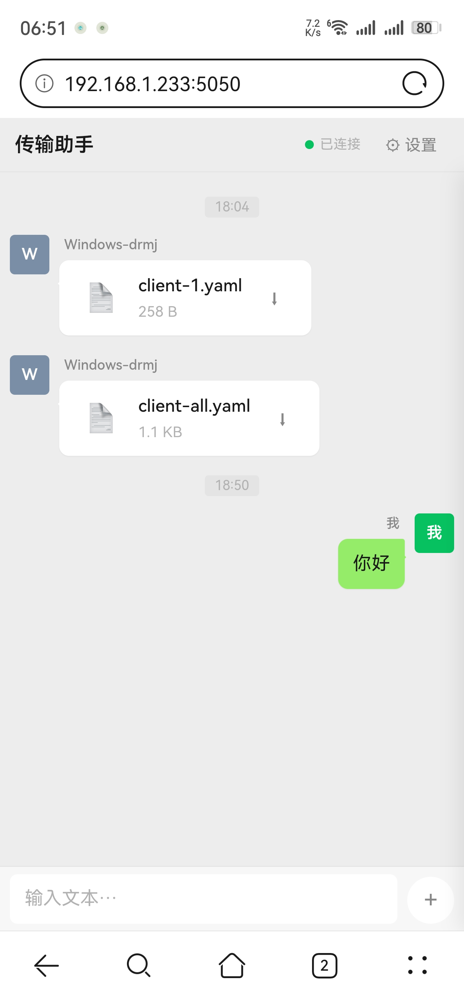
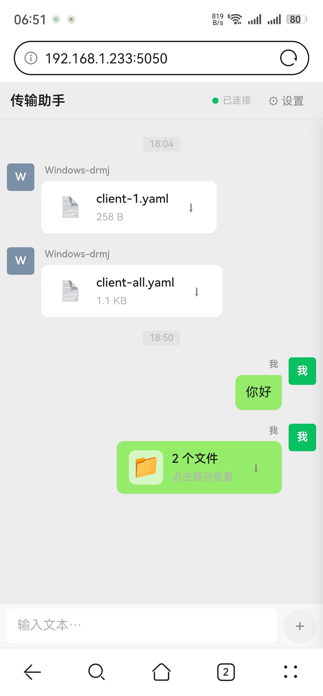
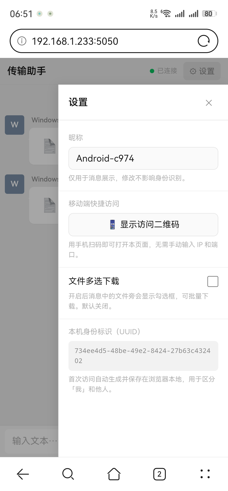

# LocalSharedTools

> 局域网里的「文件传输助手」：在电脑和手机之间，像发微信一样传文本、传文件。

`Go 1.26+` · `SQLite` · `WebSocket` · `零 CGO` · `零 token 成本` · `MIT` · `100% AI 编写`

- **代码 100% 由网页版 DeepSeek 生成**，我没有手写一行实现代码；但这是十几轮来回修改、真机测试之后才收敛的版本，不是一次成型。
- **全程零 AI 成本**：不买 token、不订阅编码 Agent，只在网页版 / App 版对话框里提需求。
- 我负责三件事：**把需求拆成功能**、**把成熟项目的好内核融进来**、**把 UI 卡在微信的观感上**。
- 单个 Go 程序 + 一个 `index.html`，没有 npm、没有构建链、没有外部服务；数据全部留在本机。

---

## 目录

- [1. 它解决什么问题](#1-它解决什么问题)
- [2. 功能一览](#2-功能一览)
- [3. 界面：为什么长这样](#3-界面为什么长这样)
- [4. 快速开始](#4-快速开始)
- [5. 目录结构](#5-目录结构)
- [6. 架构：一条消息的旅程](#6-架构一条消息的旅程)
- [7. 内核融合：站在成熟项目的肩膀上](#7-内核融合站在成熟项目的肩膀上)
- [8. 接口](#8-接口)
- [9. 设计取舍与已知限制](#9-设计取舍与已知限制)
- [10. 安全须知](#10-安全须知)
- [11. 关于「100% AI 写代码」](#11-关于100-ai-写代码)
- [12. Roadmap](#12-roadmap)
- [13. 参与贡献](#13-参与贡献)
- [14. 许可证](#14-许可证)
- [15. 致谢](#15-致谢)

---

## 1. 它解决什么问题

局域网里传点东西，常见方案各有各的别扭：

| 方案 | 痛点 |
| --- | --- |
| 微信「文件传输助手」/ 网盘 | 绕一圈公网，慢；敏感文件不想上传 |
| LocalSend 等客户端 | 两边都得装，公司电脑未必让装 |
| SMB / FTP / 共享文件夹 | 配置门槛高，手机端体验差 |
| `python -m http.server` | 只能下载，不能发消息、不能上传、没有界面 |

本项目的目标很简单：**对方只需要一个浏览器。**

- 零安装：手机扫码即开
- 零账号：没有注册登录，打开就能用
- 零外网：所有数据不出局域网
- 零心智负担：界面就是微信，不用看说明书

## 2. 功能一览

| 功能 | 说明 |
| --- | --- |
| 文本消息 | WebSocket 实时推送，发送即达 |
| 文件上传 | 多选文件、逐个顺序上传，避免把局域网打满 |
| 在线预览 | 图片、视频直接看；PDF 用浏览器内嵌阅读器 |
| 文件自动合组 | 同一人 60 秒内的多个文件合成一张卡片，点开展开 |
| 批量下载 | 设置里打开勾选框，工具栏一键下载选中项 |
| 扫码访问 | 服务端实时生成二维码，手机扫一下就能打开 |
| 昵称与身份 | 首次访问自动生成 UUID 存本地，用来区分「我」和「他人」 |
| 历史持久化 | 消息与文件记录落 SQLite，重启不丢 |
| 断线重连 | 指数退避，1s → 2s → 4s → … 上限 30s，回到页面自动补连 |
| 时间分隔 | 相邻消息间隔超过 5 分钟，自动插入时间标签 |
| 端口防冲突 | 借鉴 ServerGo 内核：端口被占自动顺延（最多试 100 个），二维码始终使用真实端口 |
| 单实例保护 | 同一 exe 已经在跑，直接打开浏览器并退出，不重复起服务 |
| 移动端适配 | `100dvh` + `safe-area-inset-bottom`，刘海屏不挡输入框 |
| 启动即用 | 启动后自动拉起默认浏览器；日志落文件，GUI 编译版也能排查 |

## 3. 界面：为什么长这样

UI 不是"随便做个聊天页"，而是把微信里大家最熟悉的几件事原样搬了过来：**绿白配色、左右气泡、方块头像、时间分隔、右上设置抽屉、底部一条输入栏。**

三张 Android 手机实拍（同一 Wi-Fi 下访问 `192.168.1.233:5050`）：

| 首页 | 文件集合 | 设置抽屉 |
| :---: | :---: | :---: |
|  |  |  |
| 文本 / 文件消息、连接状态、时间分隔 | 同一人 60 秒内的文件合成一张卡片 | 昵称、二维码入口、批量下载开关、本机 UUID |

电脑端只是把同款布局铺宽（内容区最大 820px），交互与手机完全一致。

布局结构（对应上面的截图）：

```
┌──────────────────────────────┐
│ 传输助手           ● 已连接 ⚙ │  ← 连接状态灯 + 设置抽屉
├──────────────────────────────┤
│         ── 18:03 ──          │  ← 间隔 > 5 分钟插入时间标签
│  ┌──┐  张三                  │
│  │张│  ┌────────────┐        │  ← 他人：头像在左、白气泡
│  └──┘  │ 这张图发你  │        │
│        └────────────┘        │
│                  我  ┌──┐    │
│        ┌──────────┐ │我│    │  ← 我：头像在右、绿气泡
│        │ 收到 👍   │ └──┘    │
│        └──────────┘          │
│  ┌──┐  ┌──────────────────┐  │
│  │我│  │ 📁 3 个文件   ⬇  │  │  ← 同人 60 秒内的文件自动合组
│  └──┘  └──────────────────┘  │
├──────────────────────────────┤
│ [输入文本…]              ＋ ➤ │
└──────────────────────────────┘
```

配色直接令牌化，想换主题只改一处：

```css
--wx-green:        #07c160;  /* 微信主绿 */
--wx-bg:           #ededed;  /* 聊天背景 */
--wx-bubble-self:  #95ec69;  /* 自己气泡 */
--wx-bubble-other: #ffffff;  /* 他人气泡 */
--wx-text:         #191919;
--wx-text-muted:   #b2b2b2;
```

几个为「中国人习惯」做的小细节：

- **Enter 发送、Shift+Enter 换行**，并且判断了中文输入法合成状态（`isComposing`），打字选词时不会误发。
- **输入框有内容才出现「发送」按钮**，空输入时显示「＋」上传按钮，和微信的交互节奏一致。
- **头像取昵称首字**，没有头像上传，降低使用门槛。
- **右上角 ⚙ 抽屉**放昵称、二维码、批量下载开关、身份 UUID，不挤占聊天区。
- **消息用 `textContent` 渲染**，聊天内容不拼 HTML，从根上避开 XSS。

## 4. 快速开始

环境要求：Go 1.26 及以上（`go.mod` 声明 `1.26.3`）。

```bash
git clone <你的仓库地址>
cd LocalSharedTools
go run .
```

打开 `http://localhost:5050`，控制台会同时打印局域网地址，手机连同一个 Wi-Fi 扫码即可。

构建成可双击运行的 Windows 程序（无控制台窗口）：

```bash
go build -ldflags "-H windowsgui" -o LocalShT.exe .
```

> 注意：`static/index.html` 必须和 exe 放在一起（程序会先找 exe 同级的 `static/`，再找当前工作目录的 `static/`），打包分发时别漏掉这个目录。

启动参数：

| 参数 | 默认值 | 说明 |
| --- | --- | --- |
| `-port` | `5050` | 监听端口；被占用会自动向后顺延（最多 100 个） |
| `-dir` | `LocalShT-shared` | 上传文件的落盘目录，不存在会自动创建 |
| `-db` | `data/LocalShT.db` | SQLite 数据库路径 |
| `-history` | `200` | 页面打开时加载的历史条数 |

运行时产物：

- `data/LocalShT.db` —— 消息与文件元数据
- `data/LocalShT.log` —— 运行日志（GUI 编译版没有控制台，排查全靠它）
- `LocalShT-shared/` —— 上传的文件本体

## 5. 目录结构

```
LocalSharedTools/
├── main.go              # 全部后端逻辑：DB、Hub、路由、单实例检测
├── go.mod / go.sum
├── static/
│   └── index.html       # 单文件前端：结构 + 样式 + 逻辑全在一起
├── data/                # 运行时生成：SQLite + 日志（勿提交）
└── LocalShT-shared/     # 运行时生成：上传文件落盘（勿提交）
```

没有 `pkg/`、没有 `internal/`、没有分层目录。这是一个刻意保持"单文件可读"的工具型项目：一个 `main.go` 加一个 `index.html`，打开就能从头读到尾。

## 6. 架构：一条消息的旅程

```
浏览器 A ──POST /texts──▶ Go 服务
                           │ 1. 校验 cid / content，昵称缺省补 anonymous
                           │ 2. INSERT INTO messages（SQLite，单连接串行写）
                           │ 3. Hub.broadcastMessage
                           ▼
              ┌────────────┴─────────────┐
              │ 对每一个在线客户端：      │
              │   loadRecent(50)          │
              │   → toViews(rows, 该 cid) │
              │   → 只取最后一条分组结果   │
              │   → message_upsert 单条推送│
              └────────────┬─────────────┘
                           ▼
浏览器 A / B / C ── 前端 Map 按 id upsert ── 重渲染
```

三个关键决定：

1. **广播时按「接收者」重新计算视图。** `is_self` 取决于谁在看，文件合组又依赖上下文，所以不能全局只算一份。每次广播为每个客户端取最近 50 条重算，只推最后一条。局域网规模下这点开销可以忽略。
2. **推送是幂等的 upsert，不是 append。** 前端用 `Map<id, row>` + `order[]` 维护有序集合，重复事件不会长出重复气泡；文件组合并时同一条目被覆盖更新。
3. **前后端共享同一套「视图」结构。** 服务端把 `id / is_self / display_name / time_label / files[]` 都算好，前端只负责画。前端因此不需要理解任何分组规则。

## 7. 内核融合：站在成熟项目的肩膀上

这个项目最有价值的部分不是"让 AI 写了个聊天室"，而是**先决定要抄哪些内核**，再让 AI 照着落地。我从成熟项目里挑出下面这些机制——从 WebSocket 的读写模型、ServerGo 的端口探测内核，到微信的 UI 范式——逐条约束进需求里：

| 借鉴来源 | 提炼出的内核 | 在本项目的落地 |
| --- | --- | --- |
| `gorilla/websocket` | 一连接一读一写、读写分离 | `readPump` 只读、`writePump` 只写；30s 心跳 ping、90s 读超时、10s 写超时 |
| `gorilla/websocket` | 有缓冲 channel + 丢弃策略做背压 | 每连接 `send` 缓冲 64，广播时 `select default` 丢弃，慢客户端拖不垮服务 |
| `modernc.org/sqlite` | 纯 Go 的 SQLite，无 CGO | 数据库就是一个 `.db` 文件，Windows 上零运行时依赖，交叉编译不受 CGO 限制 |
| `skip2/go-qrcode` | 服务端生成二维码 PNG | `/share/qr?url=...` 直接返回图片，手机端零 JS 依赖 |
| 微信客户端 | 设计令牌化 + 交互范式 | `--wx-*` 一整套 CSS 变量；气泡、头像、时间分隔、设置抽屉、底部输入条 |
| 协同编辑 / 事件流 | 增量事件 + 幂等合并 | 服务端只推"最后一条视图"，前端 Map 去重合并，天然抗重复与乱序 |
| ServerGo | 端口探测 + 自动更换端口 | `portInUse` 300ms 试连探占用，`listenWithFallback` 顺序试 100 个端口；真实端口回写 `actualPortGlobal`，二维码指向它而不是配置端口 |
| 本地桌面工具 | 双击即用、无脑启动 | 单实例检测、自动开浏览器、日志落盘 |
| 常见 Web 服务防护 | 路径规范化 + 类型白名单 | `withinRoot` 校验、`filepath.Base` 去目录、`inline` 仅对图片/视频/PDF 生效 |

### 7.1 为什么文件要「合组」

一次选 5 张图发送，如果逐条渲染，聊天区会瞬间被 5 个几乎一样的气泡刷屏。服务端把**同一客户端、时间相邻（≤ 60s）**的文件消息合并成一个 `MessageView`，前端渲染为「📁 3 个文件」的卡片，点开才列出明细。

更关键的是：新文件到达时复用的是**组首条消息的 id**，前端一个 upsert 就把卡片从 "2 个文件" 更新成 "3 个文件"，不需要删除重建。

### 7.2 为什么前端不用框架

没有 Vue/React，没有打包步骤，`index.html` 直接用浏览器打开源码就能读。理由很实际：

- 分发简单：拷一个 exe + 一个 static 目录就能跑，不需要 Node 环境。
- 调试直接：改完刷新页面就生效，没有 sourcemap。
- 代价：手写 DOM，状态管理靠 `Map + order[]`，代码量比框架多一点。

对一个局域网小工具来说，这个交换是划算的。

### 7.3 端口检测与自动更换：来自 ServerGo 的内核

局域网工具最尴尬的失败不是报错，而是"看着启动了，但页面打不开"——端口被旧进程或别的软件占着。这个内核从 **ServerGo** 项目搬来：**不假设端口一定可用，先探测，失败就换，并把真实端口贯穿到每一个对外出口。**

分三步：

1. **探测**：`portInUse(p)` 用 `net.DialTimeout("tcp", "127.0.0.1:5050", 300ms)` 试连，连上就说明有人在监听，直接跳过。探测与绑定互不干扰，也不会因为一次失败的 `Listen` 污染状态。
2. **换端口**：`listenWithFallback(5050, 100)` 从起始端口顺序往后试，跳过占用者，只有 `net.Listen(":p")` 真正成功才返回 `(listener, p)`。100 个都失败就明确报错退出——不静默退化成随机端口，用户至少知道出了什么问题。
3. **贯穿真实端口**：`actualPortGlobal` 记录最终监听端口，`/share/info` 用它拼局域网地址，二维码据此生成，启动日志打印的也是它。少这一环，用户扫到的就是那个被占用的 5050，页面永远打不开。

```go
for p := startPort; p < startPort+maxTries && p <= 65535; p++ {
    if portInUse(p) {
        continue // 被占用，试下一个
    }
    if ln, err := net.Listen("tcp", fmt.Sprintf(":%d", p)); err == nil {
        return ln, p, nil
    }
}
```

两个刻意的选择：**顺序试探而非随机端口**，地址可预测、方便口头告诉同事；**上限 100 个**，避免端口扫描式地无限找下去。

再叠一层同 exe 识别：如果占用端口的就是同一个程序（`netstat` 找 PID → Win32 `QueryFullProcessImageName` 查 exe 路径 → 与自身路径比较），说明用户重复双击了，直接打开浏览器指向旧实例后退出，而不是再起第二个服务。

### 7.4 为什么数据库要「串行写」

`db.SetMaxOpenConns(1)` 把并发压成单连接。SQLite 本身写操作就是串行的，单连接避免了 `database is locked` 的偶发错误，代价只是写入排队——局域网几十人的场景完全够用。

## 8. 接口

| 方法 | 路径 | 说明 |
| --- | --- | --- |
| `GET` | `/` | 聊天页面 |
| `GET` | `/ws?cid=` | WebSocket 连接，携带本机 UUID |
| `GET` | `/history?cid=&limit=` | 历史消息（`limit` 上限 2000） |
| `POST` | `/texts` | 发文本，表单字段 `cid`、`username`、`content` |
| `POST` | `/upload` | 上传文件，`multipart/form-data`，字段 `file`（可多个）、`cid`、`username` |
| `GET` | `/download?msg=ID` | 按消息 ID 下载；`inline=1` 用于预览 |
| `GET` | `/download?file=相对路径` | 按路径下载（仍受共享目录边界约束） |
| `GET` | `/share/info` | 返回本机局域网地址、IP 列表、实际端口 |
| `GET` | `/share/qr?url=` | 返回 256px PNG 二维码 |

WebSocket 事件只有两种，都是服务端 → 客户端：

```json
{ "type": "history", "rows": [ /* MessageView 数组 */ ] }
```

```json
{ "type": "message_upsert", "row": { /* 单条 MessageView */ } }
```

`MessageView` 的核心字段：

```json
{
  "id": 42,
  "kind": "file",
  "is_self": true,
  "display_name": "我",
  "avatar_text": "我",
  "time_label": "18:03",
  "show_divider": true,
  "file_count": 3,
  "files": [
    { "id": 42, "filename": "a.png", "size_text": "1.2 MB",
      "preview_kind": "image", "download_url": "/download?msg=42" }
  ]
}
```

## 9. 设计取舍与已知限制

| 项目 | 现状 | 原因 / 影响 |
| --- | --- | --- |
| 鉴权 | 无 | 前提是可信内网；同网段任何人都能读写 |
| 传输加密 | 无（HTTP / WS） | 抓包可见内容；公网使用必须先加 TLS |
| 上传大小 | 无硬上限（64 MB 仅为内存阈值） | 大文件落临时文件；注意磁盘余量 |
| 历史加载 | 默认最近 200 条（接口上限 2000） | 无分页；更早的消息仍在库里但页面不显示 |
| 删除 / 搜索 | 未实现 | 定位是「临时中转」，消息用完即弃 |
| 单实例检测 | 仅 Windows | 依赖 `netstat` 解析 + Win32 `QueryFullProcessImageName`；其他平台走端口顺延 |
| 静态资源 | 需 `static/` 随 exe 分发 | 尚未 `//go:embed`；打包时容易漏 |
| 自动化测试 | 暂无 | `toViews`、`humanSize`、`withinRoot` 都是纯函数，适合补单元测试 |
| 多用户 | 无在线列表 / 无 @ | 只区分「我」和「他人」，没有成员概念 |

## 10. 安全须知

这是一个**内网工具**，不是公网服务。请务必遵守：

1. **不要把端口映射到公网。** 程序默认监听 `0.0.0.0`，同一个 Wi-Fi / 局域网内的人都能访问。
2. **共享目录不要放敏感文件。** 上传的文件会原样落盘在 `LocalShT-shared/`，同网段可下载。
3. **提交代码前，先排除运行时数据。** 共享目录里可能有别人上传的配置、密钥、证书：

   ```gitignore
   data/
   LocalShT-shared/
   *.exe
   ```

4. **了解边界。** 下载接口有 `withinRoot` 路径穿越防护，上传接口用 `filepath.Base` 丢弃目录部分，内联预览有类型白名单，`CheckOrigin` 默认全放行——这些防的是"误操作"，不是"有备而来的攻击者"。
5. **公网化改造清单**：加访问口令或 token、强制 HTTPS、限制上传频率与总大小、独立进程账户运行、按需求加文件类型扫描。

## 11. 关于「100% AI 写代码」

先把话说清楚：**「100%」指的是代码全部由网页版 DeepSeek 输出，不是「一句话生成」。** 现在这个版本，是我和它前后拉扯了十几轮、反复修改、在双浏览器和真机上反复测试之后才收敛的。我敲下的不是代码，是需求、现象、报错，和下一轮的约束。

### 11.1 我与 AI 各干了什么

| 环节 | 我 | 网页版 DeepSeek |
| --- | --- | --- |
| 需求拆解 | 把「局域网像微信一样传东西」拆成可验收的功能点：扫码、断线重连、文件合组、批量下载…… | — |
| 技术选型 | 定死约束：单二进制、无 CGO、SQLite 持久化、单文件前端、不引框架 | — |
| 内核融合 | 指定要哪些机制：读写分离 + 有缓冲 channel、幂等 upsert、路径白名单、ServerGo 的端口探测与自动换端口…… | — |
| UI 设计 | 给出微信的设计令牌与交互规范 | — |
| 编码 | — | 按功能点产出 Go 后端与前端实现，包括数据库迁移、端口顺延、单实例检测 |
| 迭代 | 十几轮：描述现象、贴报错、跑回归、每轮重新贴约束 | 按当前上下文出补丁；上下文一断，就可能改坏已经通过的部分 |
| 验收 | 双机 / 手机实测、断网重连、端口占用、中文输入法误发 | — |
| 代码量 | 0 行手写 | 100% |

### 11.2 网页版 AI 的两个硬约束

#### 上下文窗口是有限的

项目本体就不小：`main.go` 约 1075 行，`index.html` 约 1600 行。单贴一个文件也许还放得下，但十几轮对话里还堆着需求、报错、贴回来的代码和测试结论，窗口很快见底。一旦接近上限，**最早写下的约束会最先被挤掉**，AI 只剩最近几轮的印象，于是出现这些典型症状：

- 让它修端口逻辑，它顺手把已经调好的文件分组重写了一遍；
- 上一轮刚说「下载要做路径校验」，这一轮新写的下载函数又忘了；
- 前端改完刷新，`is_self` 判断回到老写法，别人的消息显示在自己右边。

> 这是网页版最消耗人的地方：**它不是不会写，而是会忘。** 而它忘掉的约束，得由人重新贴回去。

所以我后来固定了一套做法：维护一份「决策清单」（选型、约束、验收标准），每轮只贴与本次修改相关的代码片段；开新会话时，把这份清单原样再贴一遍。**上下文不是 AI 的记忆，是我在替它保管。**

#### 算力与额度是有限的

网页版不是本地无限算力：高峰期要排队，单轮输出有长度上限，长回答可能被截断；一次生成几百行之后，质量还会肉眼可见地下滑——省略错误处理、把两个函数揉成一个、边界条件「等以后再说」。

于是只能小步走：

- 一次只让它改一个函数或一个交互，改完立刻 `go build`，再开浏览器点一遍；
- 长任务拆成「先骨架、再细节、最后联调」三段，每段验收通过再进下一段；
- 一旦输出开始截断，就主动收窄问题范围，而不是硬让它「接着把刚才没写完的补上」。

**生成快，不等于交付快。** 排队、重试、回滚、重新贴上下文，这些时间全记在我这一侧。

### 11.3 零成本路线：不买 token 也能把活干完

这个项目在 AI 上的开销是 **0 元**：没有 API key，没有按 token 计费，没有订阅 Cursor / Copilot / Claude Code 这类编码 Agent，也没有为任何「一键生成」工具付过费。所有交互都发生在**网页版和 App 版的免费对话框**里。

对普通人来说，这既是好消息，也是这套经历值得复述的原因：

- **闭环不需要付费工具。** AI 只负责输出文本代码；编译、运行、开浏览器、手机扫码、拔网线测重连、清 `localStorage` 换身份，全在本地完成。免费的对话 + 本地的 Go 工具链，已经构成完整的开发闭环。
- **不用被账单追着改需求。** 预算为 0，就没有「这个功能值不值一次 API 调用」的算计，也没有额度用完被迫停工的焦虑，节奏完全由自己定。
- **手机上也能推进。** 网页版和 App 版是同一套对话：坐在电脑前时用网页版，通勤路上用 App 补需求、改提示词、看报错，碎片时间也能往前挪一点。

代价同样明确，而且和第 11.2 的约束是同一件事：

- 没有 IDE 自动补全、没有 Agent 自动改文件、没有自动跑测试。代码要手工复制回项目，报错要手工贴回对话，改完要手工编译。
- 免费额度下的排队、截断、上下文丢失一样不少。所以「决策清单 + 小步走 + 每次只改一个函数」不是讲究，而是**没钱买省事时的唯一解**。
- 省下的钱，要用时间和纪律补上。**这条路不靠预算，靠把 AI 当「远程打字员」，而不是「自动程序员」。**

也有意外的收益：**没有供应商锁定**。哪天想换模型、换工具，把决策清单和代码一起搬过去就行——方法论是自己的，不是某个产品的。

但这条路有门槛，下一节先把丑话说清楚。

### 11.4 先把丑话说在前面：这套硬核方法不适合所有人

零成本、全手工、一个人控全局——听起来很燃，但它有明确的适用边界：**这套方法只适合有耐心、并且已经有一定工程经验积累的人。**

原因很直接：

- **耐心是硬门槛。** 十几轮里大部分时间不是在「写」，而是在描述现象、等回复、复制粘贴、重新编译、再测一遍。没有耐心的人，第一轮就会接受「能跑就行」的版本。
- **经验是判断力的来源。** AI 说「已修复」时，你得看得出它是不是真修了、有没有改坏别处；报错丢过来，你得知道该看哪一行；「端口顺延后二维码打不开」这种问题，得先想到「二维码用的可能是配置端口」。这些判断，AI 不会替你做。
- **你得自己定义「完成」。** 验收标准、回归清单、边界条件，靠的都是我的工程经验；新手往往连「该测什么」都不知道，自然也没法指挥 AI 去修。

用一张表说得更直接：

| 适合 | 不适合 |
| --- | --- |
| 有耐心，能接受十几轮往返和手工回归 | 想「一句话生成一个 App」，期待开箱即用 |
| 有编程 / 调试经验，能判断 AI 改得对不对 | 没有调试经验，AI 改坏了也说不清坏在哪 |
| 能自己拆需求、写验收标准 | 连「该测什么」都需要别人告诉 |
| 接受「AI 是打字员，不是自动程序员」 | 需要稳定交付，又愿意为工具付费——那就直接用付费编码 Agent |

这不是劝退，而是把预期摆正：**这条路省的是钱，花的是时间和经验。没有这两样，省下的钱会变成返工的成本。**

如果你是第一次接触编程，不建议把这个项目当成 AI 编程的入门模板——它是一份「一个人把工程责任全扛下来」的样本，不是「AI 自动写软件」的样本。更稳的路径是：先用现成工具满足需求，从小项目开始练「看懂报错、改坏能修」的底气，再回来走这条路。

### 11.5 十几轮里，人到底在磨什么

这些轮次很少是「推倒重写」，绝大多数是**把上一轮引入的新问题一个个摁下去**。今天的代码里还留着这些疤痕：

| 迭代中暴露的问题 | 最终怎么收敛 |
| --- | --- |
| 广播时全局只算一份视图，`is_self` 和文件组在别人屏幕上错位 | 改为每个客户端取最近 50 条重算，只推最后一条 |
| 一次发多个文件，聊天区被同款气泡刷屏 | 同一人 60 秒内合组，复用组首 id 做 upsert |
| 端口顺延之后，二维码还指向被占用的 5050，手机扫不开 | `actualPortGlobal` 贯穿到 `/share/info` 与启动日志 |
| 中文输入法选词时敲回车，消息被提前发出 | 键盘事件里判断 `isComposing` |
| 一个慢客户端把整个广播循环卡住 | 每连接 `send` 缓冲 64，广播 `select default` 丢弃 |
| 重复双击 exe，起了两个实例抢同一个端口 | `netstat` 找 PID，Win32 查 exe 路径，同路径就开浏览器退出 |
| 表结构从 `texts` 演进到 `messages` | 启动时迁移旧表，`ensureColumn` 补齐新增列 |
| 批量下载是后期才追加的需求 | 设置里加勾选开关，工具栏出「下载选中」 |

每一行的背后，都是一整套手工回归：`go build`、开两个浏览器、手机扫码、故意占掉 5050、拔网线看重连、清 `localStorage` 换身份、切中文输入法试回车。**AI 写不出这套验收流程，它只能按你贴回来的现象改。** 十几轮下来，代码是它的，把这堆现象翻译成「下一步改哪里」的判断，是我的。

### 11.6 我给 AI 的提示词长什么样

```text
角色：资深 Go 后端 + 原生前端工程师。
全局约束（每轮都要遵守）：
  1. 只用标准库 net/http + gorilla/websocket + modernc.org/sqlite，不引 ORM、不引前端框架。
  2. 后端单文件 main.go，前端单文件 static/index.html，不允许构建步骤。
  3. UI 严格使用微信配色（#07c160 / #ededed / #95ec69），气泡分左右，头像方块。
本轮任务：
  - 只改 <指定函数>，其余代码原样返回，不要重排、不要“顺手优化”。
  - 保留已有行为：60 秒合组、按接收者重算视图、对外使用真实端口。
细节：
  - Enter 发送、Shift+Enter 换行，且要判断中文输入法合成状态。
  - 下载接口必须做路径穿越校验，预览只允许图片/视频/PDF 内联。
验收标准（逐条可测）：
  - ……
```

> 提示词里最值钱的两句，是「只改指定函数」和「其余代码原样返回」——它们既给上下文窗口省地方，也防止 AI 顺手改坏别处。

### 11.7 和大冰叔的「一人成队」像在哪

十几轮磨完之后，我看到大冰叔的 [solo-to-team-skills](https://github.com/dabingfy-dot/solo-to-team-skills)（「Solo to Team · 一人成队」），第一反应是：这不就是我这十几轮的处境吗。我没有实际用过这套技能包，但那个项目的出发点——**一个人统筹 AI 干活**——和这段经历几乎重合。

它管的是「派出去的活要收回来」「说做好了要拿得出证据」「最后拍板永远是人」，流程是**提目标 → 分工 → 交接 → 核对 → 判断**。这些坑，本项目一个没少踩：约束贴过去 AI 会忘、代码说改好了得自己编译验证、同一个 bug 修了又回退。

真正不一样的是协作形态：

| 维度 | 大冰叔的「一人成队」 | 本项目 |
| --- | --- | --- |
| 协作形态 | 一个人 + 多个长期 AI 助手，按技能分工、交接、核证 | 一个人 + 一个网页版 AI，单线往返 |
| 人的角色 | 总控：定目标、派活、看证据、拍板 | **核心控制器**：需求、选型、内核、UI、验收、回归全包 |
| AI 的角色 | 团队里的执行者，按技能做派收与核证 | 纯执行器：输出代码、修正 bug |
| 证据与验收 | 技能内置「交活前要有证据」的流程 | 我自己写验收清单，逐条手工回归 |
| 共同点 | 人始终掌握判断权；「做完了」必须有可检查的证据；上下文的连续性靠人维护 | 同左 |

直白一点：**大冰叔是把一个人组织成一支团队，我是把一个人当成一台控制器。** 那边有技能替人分担派活和核证的流程；这边没有队友，所有环节——包括「AI 到底改对了没有」——都得我自己盯。

这也解释了为什么是十几轮：**本项目没有「团队」可以分摊验证成本。AI 每交一次代码，我就要当一次产品、一次测试、一次运维。** 好处是控制权高度集中，需求不会在传递中失真；代价是每一轮的等待、试错、回归，都只能一个人扛。

### 11.8 一点体会

- **需求拆得越细，AI 产出的代码越稳。** 「做个文件传输工具」只能换来玩具；「同一人 60 秒内合组、组 id 复用首条、前端 upsert 更新」才能换来能用的功能。
- **内核必须由人来选。** AI 默认会写出“能跑”的广播循环，不会主动告诉你 send channel 要带缓冲、要用 `default` 丢弃慢客户端——这种判断来自对成熟项目的阅读。
- **验收标准要写成可测的句子。** 「断网 10 秒后自动重连」「端口被占时自动切到 5051」比「要稳定」有用一百倍。
- **上下文要自己管。** 把全局约束压缩成一小段可复制的“头部”，每轮贴回去；它忘了就再贴，不指望它记住。这活儿看起来琐碎，却是十几轮里最能决定成败的一环。
- **算力要省着用。** 一次只改一个函数，改完立刻测，别让它“顺手优化”别处——那通常是回滚的开始。
- **零预算也能做完。** 免费网页版 + 本地编译 + 手工回归，足够撑起一个万行以内的小工具；真正的门槛不是钱，是把流程当工程做的耐心。

所以，**「100% AI 写代码」是技术事实，但项目能不能用，取决于那十几轮里反复贴上下文、反复扫码测试的人**——而这个人，没有为 AI 花过一分钱，花掉的是耐心，和多年攒下的工程经验。

## 12. Roadmap

- [ ] 用 `//go:embed` 把 `static/` 打进二进制，真正单文件分发
- [ ] 支持拖拽上传、粘贴截图上传
- [ ] 消息删除、关键字搜索、历史分页
- [ ] 访问口令 + 可选 HTTPS
- [ ] 文件夹传输（打包 zip 或流式写入）
- [ ] `toViews` / `humanSize` / `withinRoot` 的单元测试
- [ ] 多语言（至少中英切换）

## 13. 参与贡献

欢迎 issue 和 PR。提交前请保持两条原则：

1. **保持简单**：后端单文件、前端单文件、不引入构建链。加依赖需要说清楚为什么非加不可。
2. **功能自带验收说明**：PR 描述里写清"怎么测"，涉及 UI 的附一句预期表现。

## 14. 许可证

本项目以 **MIT License** 开源（仓库中的 `LICENSE` 文件待补充）。你可以自由使用、修改、分发，保留版权声明即可。

## 15. 致谢

- [gorilla/websocket](https://github.com/gorilla/websocket) —— 稳定可靠的 WebSocket 实现
- [modernc.org/sqlite](https://gitlab.com/cznic/sqlite) —— 让纯 Go 也能拥有 SQLite
- [skip2/go-qrcode](https://github.com/skip2/go-qrcode) —— 二维码生成
- [ServerGo](https://github.com/servergoservergo/servergo)  —— 端口占用探测与自动换端口的内核出处
- [solo-to-team-skills](https://github.com/dabingfy-dot/solo-to-team-skills) —— 「一人成队」的方法论参照；本项目是它的极端变体：一人成控制器
- 微信客户端 —— UI 与交互的灵感来源

---

**文档和代码一样：我提要求，AI 落笔。**
